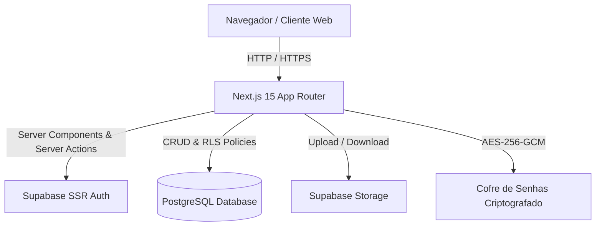
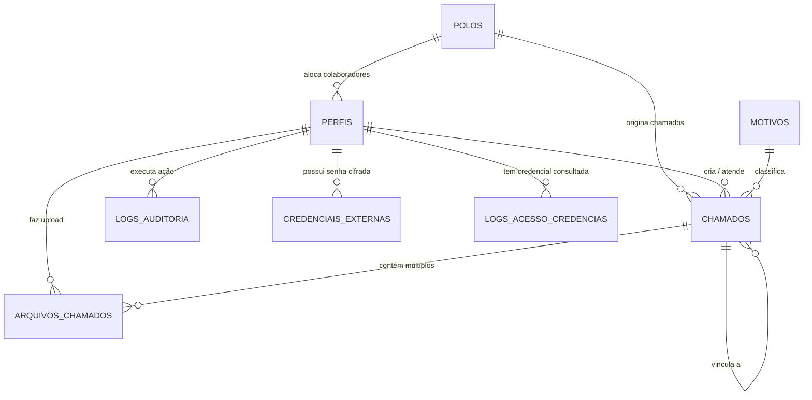

# Documentação Completa do Sistema de Gestão de Chamados

---

## 1. Visão Geral do Sistema

O **Sistema de Gestão de Chamados e Protocolos Acadêmicos** é uma solução corporativa _full-stack_ desenvolvida para a **UNOPAR / Grupo Educacional Edunorte**. O sistema gerencia todo o ciclo de vida dos protocolos acadêmicos e operacionais, fornecendo controle de prazos (SLA), edição colaborativa com rastreabilidade visível, métricas de produtividade em tempo real, cofre seguro de credenciais com criptografia avançada e trilha imutável de auditoria.

### 1.1. Principais Pilares

- **Atendimento e SLA Rigoroso:** Acompanhamento de protocolos com prazos automáticos de 5 dias úteis, alertas visuais para chamados vencendo em até 2 dias e vencidos.
- **Edição Colaborativa com Rastreamento Visível:** Colaboradoras podem complementar chamados de colegas; o sistema grava e exibe publicamente o histórico de quem editou e o timestamp exato, impedindo exclusões não autorizadas.
- **Anexo Múltiplo de Arquivos (1:N):** Suporte ao upload de múltiplos documentos (PDF, imagens, planilhas) associados a cada chamado, armazenados de forma segura em _Storage Buckets_ do Supabase.
- **Painel de Indicadores & Desempenho Gamificado:** Dashboard analítico e tela de desempenho com fórmula tripartida (Volume 40%, Prazo 40%, Agilidade 20%), troféu 3D, ondas decorativas em SVG, pódio e gráficos históricos.
- **Cofre de Credenciais Externas com AES-256-GCM:** Armazenamento seguro de senhas institucionais com criptografia simétrica autenticada e log de acesso com captura de IP e User-Agent.
- **Trilha de Auditoria Geral:** Registro automático de todas as operações de criação, alteração e exclusão lógica, com comparativo detalhado _antes/depois_.

---

## 2. Arquitetura e Tecnologias



### 2.1. Stack Tecnológico

| Camada                   | Tecnologia                     | Descrição                                                                               |
| :----------------------- | :----------------------------- | :-------------------------------------------------------------------------------------- |
| **Framework Web**        | Next.js 15 (App Router)        | Renderização híbrida (SSR / Client Components), Server Actions e rotas de API           |
| **Linguagem**            | TypeScript 5 (Strict Mode)     | Tipagem estática rigorosa para todas as entidades e ações                               |
| **Estilização & UI**     | Tailwind CSS 3.4               | Sistema de design corporativo responsivo com tokens para 3 temas (Claro, Sépia, Escuro) |
| **Ícones**               | Lucide React                   | Biblioteca moderna e unificada de ícones SVG                                            |
| **Gráficos**             | Recharts                       | Visualizações dinâmicas de séries temporais, barras verticais e horizontais             |
| **Banco de Dados**       | Supabase / PostgreSQL 15+      | Banco relacional com Row Level Security (RLS) e Triggers                                |
| **Autenticação**         | Supabase Auth (@supabase/ssr)  | Sessões gerenciadas via cookies HTTP-only com tokens JWT                                |
| **Criptografia**         | Node.js Crypto (`aes-256-gcm`) | Criptografia simétrica com vetor de inicialização (IV) e Tag de Autenticação            |
| **Manipulação de Datas** | Date-fns & Date-fns/tz         | Formatação ISO 8601, cálculos de dias úteis e fuso horário `America/Sao_Paulo`          |

---

## 3. Modelo de Dados (Schema Relacional)

O modelo relacional é composto por 8 tabelas principais, implementadas com chaves estrangeiras, restrições de integridade, índices de busca e triggers de auditoria.



### 3.1. Tabela: `polos`

Gerencia as unidades físicas/cidades atendidas pelo sistema no Pará (Parauapebas, Canaã dos Carajás, Eldorado dos Carajás).

| Coluna      | Tipo               | Nulo | Descrição / Restrição                              |
| :---------- | :----------------- | :--: | :------------------------------------------------- |
| `id`        | `UNIQUEIDENTIFIER` | NÃO  | Chave Primária (`NEWID()`)                         |
| `nome`      | `NVARCHAR(100)`    | NÃO  | Nome do polo (ex: `'Polo Parauapebas'`)            |
| `codigo`    | `NVARCHAR(10)`     | NÃO  | Código sigla único (ex: `'PQB'`, `'CCJ'`, `'ELD'`) |
| `cidade`    | `NVARCHAR(100)`    | NÃO  | Cidade sede da unidade                             |
| `estado`    | `NVARCHAR(2)`      | NÃO  | Sigla da UF (Padrão: `'PA'`)                       |
| `ativo`     | `BIT`              | NÃO  | Status da unidade (Padrão: `1`)                    |
| `criado_em` | `DATETIMEOFFSET`   | NÃO  | Data de cadastro (Padrão: `SYSDATETIMEOFFSET()`)   |

---

### 3.2. Tabela: `usuarios` / `perfis`

Armazena os dados cadastrais, polo de vinculação e o perfil de acesso dos operadores do sistema.

| Coluna          | Tipo               | Nulo | Descrição / Restrição                                       |
| :-------------- | :----------------- | :--: | :---------------------------------------------------------- |
| `id`            | `UNIQUEIDENTIFIER` | NÃO  | Chave Primária                                              |
| `nome_completo` | `NVARCHAR(255)`    | NÃO  | Nome completo do operador                                   |
| `email`         | `NVARCHAR(255)`    | NÃO  | E-mail corporativo único (`UNIQUE`)                         |
| `papel`         | `NVARCHAR(50)`     | NÃO  | Papel do usuário: `'admin'`, `'coordenador'`, `'atendente'` |
| `polo_id`       | `UNIQUEIDENTIFIER` | SIM  | FK referenciando `polos(id)` da unidade do colaborador      |
| `ativo`         | `BIT`              | NÃO  | Status da conta (Padrão: `1`)                               |
| `criado_em`     | `DATETIMEOFFSET`   | NÃO  | Data de cadastro (Padrão: `SYSDATETIMEOFFSET()`)            |
| `atualizado_em` | `DATETIMEOFFSET`   | NÃO  | Timestamp da última modificação                             |

---

### 3.3. Tabela: `chamados`

Entidade central do sistema. Registra as solicitações acadêmicas, polo de origem e os atendimentos.

| Coluna                 | Tipo               | Nulo | Descrição / Restrição                                       |
| :--------------------- | :----------------- | :--: | :---------------------------------------------------------- |
| `id`                   | `UNIQUEIDENTIFIER` | NÃO  | Chave Primária (`NEWID()`)                                  |
| `protocolo`            | `NVARCHAR(30)`     | NÃO  | Código único legível (ex: `CS20260902-1234`)                |
| `aluno_nome`           | `NVARCHAR(255)`    | NÃO  | Nome do estudante solicitante                               |
| `aluno_ra`             | `NVARCHAR(50)`     | SIM  | Registro Acadêmico (RA) do estudante                        |
| `aluno_cpf`            | `NVARCHAR(14)`     | SIM  | CPF do estudante com máscara (`000.000.000-00`)             |
| `polo_id`              | `UNIQUEIDENTIFIER` | SIM  | FK referenciando `polos(id)` da unidade do chamado          |
| `contato_telefone`     | `NVARCHAR(50)`     | SIM  | Telefone / WhatsApp de contato                              |
| `motivo_id`            | `UNIQUEIDENTIFIER` | NÃO  | FK referenciando `motivos(id)`                              |
| `descricao`            | `NVARCHAR(MAX)`    | SIM  | Descrição detalhada da solicitação                          |
| `situacao`             | `NVARCHAR(30)`     | NÃO  | Situação: `'aguardando'`, `'concluido'`, `'encerrado'`      |
| `prioridade`           | `NVARCHAR(20)`     | NÃO  | Prioridade: `'normal'`, `'priorizar'`                       |
| `data_solicitacao`     | `DATETIMEOFFSET`   | NÃO  | Data e hora de abertura do protocolo                        |
| `prazo`                | `DATETIMEOFFSET`   | NÃO  | Data limite regulamentar de conclusão (SLA de 5 dias úteis) |
| `data_conclusao`       | `DATETIMEOFFSET`   | SIM  | Data e hora em que o chamado foi finalizado                 |
| `chamado_vinculado_id` | `UNIQUEIDENTIFIER` | SIM  | FK auto-relacionamento com outro `chamado(id)`              |
| `observacao`           | `NVARCHAR(MAX)`    | SIM  | Parecer técnico e anotações internas                        |
| `importado`            | `BIT`              | NÃO  | Flag indicando se o registro veio de migração externa       |
| `criado_por`           | `UNIQUEIDENTIFIER` | NÃO  | FK referenciando `perfis(id)` do autor                      |
| `criado_por_nome`      | `NVARCHAR(255)`    | SIM  | Snapshot do nome do autor no momento da criação             |
| `atualizado_por`       | `UNIQUEIDENTIFIER` | SIM  | FK referenciando o último usuário que editou o chamado      |
| `atualizado_por_nome`  | `NVARCHAR(255)`    | SIM  | Nome do último editor para rastreamento visual              |
| `criado_em`            | `DATETIMEOFFSET`   | NÃO  | Timestamp de criação                                        |
| `atualizado_em`        | `DATETIMEOFFSET`   | NÃO  | Timestamp da última edição                                  |
| `excluido_em`          | `DATETIMEOFFSET`   | SIM  | Data da exclusão lógica (_soft delete_)                     |
| `excluido_por`         | `UNIQUEIDENTIFIER` | SIM  | FK referenciando o usuário que executou a exclusão          |

---

### 3.4. Tabela: `arquivos_chamados`

Permite o vínculo de múltiplos documentos anexados a um chamado (relação 1:N).

| Coluna            | Tipo               | Nulo | Descrição / Restrição                               |
| :---------------- | :----------------- | :--: | :-------------------------------------------------- |
| `id`              | `UNIQUEIDENTIFIER` | NÃO  | Chave Primária (`NEWID()`)                          |
| `chamado_id`      | `UNIQUEIDENTIFIER` | NÃO  | FK referenciando `chamados(id)` (ON DELETE CASCADE) |
| `nome_original`   | `NVARCHAR(255)`    | NÃO  | Nome do arquivo original no upload                  |
| `caminho_storage` | `NVARCHAR(500)`    | NÃO  | Caminho relativo em disco seguro de anexos          |
| `tamanho_bytes`   | `BIGINT`           | SIM  | Tamanho do arquivo em bytes                         |
| `tipo_mime`       | `NVARCHAR(100)`    | SIM  | MIME Type (ex: `application/pdf`, `image/png`)      |
| `descricao`       | `NVARCHAR(255)`    | SIM  | Descrição ou observação sobre o documento           |
| `criado_por`      | `UNIQUEIDENTIFIER` | NÃO  | FK referenciando `perfis(id)` de quem anexou        |
| `criado_por_nome` | `NVARCHAR(255)`    | SIM  | Nome de quem fez o upload                           |
| `criado_em`       | `DATETIMEOFFSET`   | NÃO  | Data de upload                                      |

---

### 3.5. Tabela: `motivos`

Catálogo de categorias de solicitações acadêmicas.

| Coluna             | Tipo               | Nulo | Descrição / Restrição                                  |
| :----------------- | :----------------- | :--: | :----------------------------------------------------- |
| `id`               | `UNIQUEIDENTIFIER` | NÃO  | Chave Primária (`NEWID()`)                             |
| `numero`           | `INT`              | NÃO  | Identificador numérico sequencial                      |
| `codigo`           | `NVARCHAR(10)`     | NÃO  | Código formatado único (ex: `#01`, `#02`, `#15`)       |
| `nome`             | `NVARCHAR(255)`    | NÃO  | Nome oficial da categoria                              |
| `nome_normalizado` | `NVARCHAR(255)`    | NÃO  | Nome em minúsculas e sem acentos para busca rápida     |
| `ativo`            | `BIT`              | NÃO  | Se o motivo está disponível para seleção (Padrão: `1`) |
| `criado_por`       | `UNIQUEIDENTIFIER` | SIM  | FK referenciando `perfis(id)`                          |
| `criado_em`        | `DATETIMEOFFSET`   | NÃO  | Timestamp de criação                                   |

---

### 3.6. Tabela: `logs_auditoria`

Trilha imutável de auditoria corporativa.

| Coluna             | Tipo               | Nulo | Descrição / Restrição                                   |
| :----------------- | :----------------- | :--: | :------------------------------------------------------ |
| `id`               | `BIGINT IDENTITY`  | NÃO  | Chave Primária sequencial                               |
| `tabela`           | `NVARCHAR(50)`     | NÃO  | Nome da tabela alterada (ex: `'chamados'`, `'perfis'`)  |
| `registro_id`      | `NVARCHAR(100)`    | SIM  | ID do registro afetado                                  |
| `operacao`         | `NVARCHAR(10)`     | NÃO  | Operação executada: `'INSERT'`, `'UPDATE'`, `'DELETE'`  |
| `dados_antes`      | `NVARCHAR(MAX)`    | SIM  | Snapshot JSON do registro antes da alteração            |
| `dados_depois`     | `NVARCHAR(MAX)`    | SIM  | Snapshot JSON do registro após a alteração              |
| `campos_alterados` | `NVARCHAR(MAX)`    | SIM  | Lista JSON com os nomes das colunas modificadas         |
| `usuario_id`       | `UNIQUEIDENTIFIER` | SIM  | FK referenciando o operador responsável                 |
| `usuario_nome`     | `NVARCHAR(255)`    | SIM  | Nome do operador                                        |
| `protocolo`        | `NVARCHAR(50)`     | SIM  | Protocolo relacionado quando a operação for em chamados |
| `ip`               | `NVARCHAR(45)`     | SIM  | Endereço IP do cliente                                  |
| `criado_em`        | `DATETIMEOFFSET`   | NÃO  | Timestamp exato da operação                             |

---

### 3.7. Tabelas do Cofre de Credenciais: `credenciais_externas` e `credencial_acessos`

#### `credenciais_externas`

| Coluna           | Tipo                  | Descrição                                                            |
| :--------------- | :-------------------- | :------------------------------------------------------------------- |
| `perfil_id`      | `UNIQUEIDENTIFIER PK` | FK referenciando `perfis(id)`                                        |
| `senha_cifrada`  | `VARBINARY(MAX)`      | Texto cifrado com o algoritmo AES-256-GCM                            |
| `iv`             | `VARBINARY(16)`       | Vetor de Inicialização único de 16 bytes                             |
| `auth_tag`       | `VARBINARY(16)`       | Tag de Autenticação GCM de 16 bytes para proteção contra adulteração |
| `atualizado_em`  | `DATETIMEOFFSET`      | Data da última atualização da senha                                  |
| `atualizado_por` | `UNIQUEIDENTIFIER`    | FK referenciando o administrador que atualizou                       |

#### `credencial_acessos`

| Coluna        | Tipo                 | Descrição                                   |
| :------------ | :------------------- | :------------------------------------------ |
| `id`          | `BIGINT IDENTITY PK` | Identificador sequencial do log             |
| `perfil_alvo` | `UNIQUEIDENTIFIER`   | ID do usuário cuja senha foi consultada     |
| `admin_id`    | `UNIQUEIDENTIFIER`   | ID do administrador que realizou a consulta |
| `data_hora`   | `DATETIMEOFFSET`     | Momento exato da visualização               |
| `ip`          | `NVARCHAR(45)`       | Endereço IP do administrador                |
| `user_agent`  | `NVARCHAR(MAX)`      | Informações do navegador e SO               |

---

## 4. Tipos e Interfaces TypeScript (`types/database.ts`)

```typescript
export type PapelUsuario = "admin" | "coordenador" | "atendente";
export type SituacaoChamado = "aguardando" | "concluido" | "encerrado";
export type PrioridadeChamado = "normal" | "priorizar";

export interface Polo {
  id: string;
  nome: string;
  codigo: string;
  cidade: string;
  estado: string;
  ativo: boolean;
  criado_em: string;
}

export interface Usuario {
  id: string;
  nome_completo: string;
  email: string;
  papel: PapelUsuario;
  ativo: boolean;
  polo_id?: string | null;
  polo_nome?: string | null;
  polo_cidade?: string | null;
  criado_em: string;
  atualizado_em: string;
}

export type Perfil = Usuario;

export interface Chamado {
  id: string;
  protocolo: string;
  aluno_nome: string;
  aluno_ra?: string | null;
  aluno_cpf?: string | null;
  contato_telefone?: string | null;
  motivo_id: string;
  descricao?: string | null;
  situacao: SituacaoChamado;
  prioridade: PrioridadeChamado;
  data_solicitacao: string;
  prazo: string;
  data_conclusao?: string | null;
  chamado_vinculado_id?: string | null;
  observacao?: string | null;
  importado: boolean;
  polo_id?: string | null;
  polo_nome?: string | null;
  polo_cidade?: string | null;
  polo_codigo?: string | null;
  criado_por: string;
  criado_por_nome?: string | null;
  atualizado_por?: string | null;
  atualizado_por_nome?: string | null;
  criado_em: string;
  atualizado_em: string;
  excluido_em?: string | null;
  excluido_por?: string | null;
  arquivos?: ArquivoChamado[];
}

export interface ArquivoChamado {
  id: string;
  chamado_id: string;
  nome_original: string;
  caminho_storage: string;
  tamanho_bytes?: number | null;
  tipo_mime?: string | null;
  descricao?: string | null;
  criado_por: string;
  criado_por_nome?: string | null;
  criado_em: string;
}

export interface RankingItem {
  posicao: number;
  usuario_id: string;
  nome_completo: string;
  email: string;
  papel: PapelUsuario;
  volume_total: number;
  resolvidos: number;
  encerrados: number;
  aguardando: number;
  volume_ponderado: number;
  no_prazo: number;
  taxa_prazo: number;
  tempo_medio_dias: number;
  pontos_volume: number;
  pontos_prazo: number;
  pontos_agilidade: number;
  pontos_total: number;
}
```

---

## 5. Módulos e Funcionalidades do Sistema

### 5.1. Painel Principal de Indicadores (`/painel`)

- **Filtro Multi-Polo & Temporal:** Dropdown de seleção de Polo (Consolidado ou específico por Parauapebas, Canaã dos Carajás, Eldorado dos Carajás) e período (Mês atual, Semestre letivo, 12 meses).
- **Cards Analíticos Superiores:** Total de chamados, Aguardando, Concluídos, Taxa Global, Vencidos em Aberto e Vencendo em 2 Dias. Cada card possui cor semântica e suporte a clique para abertura de modal de detalhamento.
- **Modal Interativo de Detalhamento:** Permite pesquisar protocolos, verificar datas de vencimento e navegar diretamente para a demanda.
- **Ranking de Atendimento da Equipe:**
  - Exibição de cards individuais com medalhas de pódio (1º, 2º e 3º lugares).
  - Barras proporcionais de alta visibilidade: **Azul Cobalto** para resolvidos e **Vermelho** para pendências em aberto.
  - Métricas de volume total atribuído e tempo médio de solução em dias.
- **Gráficos Analíticos:**
  - Volume mensal de chamados nos últimos 12 meses.
  - Distribuição dos motivos acadêmicos mais recorrentes.
  - Tempo médio por motivo (com linha de média geral).
  - Taxa histórica de cumprimento de prazos (meta de 90%).

---

### 5.2. Acompanhamento de Desempenho (`/desempenho`)

Tela com foco em produtividade individual e coletiva com suporte a filtros por Polo e Semestre:

- **Filtro por Polo e Período:** Permite comparar o desempenho da equipe geral ou segmentada por unidade.
- **Hero Banner:** Saudação personalizada, colocação no ranking e estimativa de pontos para subir de posição.
- **4 Cards com Indicadores Estratégicos:**
  1. _⚡ Pontuação Total:_ Composição dos 3 pilares (Volume 40%, Prazo 40%, Agilidade 20%).
  2. _✅ Chamados Concluídos:_ Total com resolução efetiva.
  3. _🎯 Cumprimento de Prazo:_ Taxa percentual e meta institucional de 90%.
  4. _⏱️ Tempo Médio:_ Dias úteis médios até a solução.
- **Destaques de Atendimento (Pódio):** Pódio em degraus com 1º, 2º e 3º colocados ou estado de incentivo.
- **Progresso no Mês (Gauge Circular SVG):** Anel dinâmico indicando o percentual de meta atingida e modal explicativo com a fórmula de pontuação.
- **Tabela de Classificação Geral:** Lista consolidada com avatares, destaque para o usuário logado com tag **"Você"** e dados de pontuação detalhados.
- **Evolução Histórica Pessoal (6 Meses):** Gráfico de linhas comparando o histórico do operador com a média da equipe.

---

### 5.3. Módulo de Chamados (`/chamados`)

- **Identificação do Aluno (CPF & RA):** Campo de CPF com máscara de digitação (`000.000.000-00`), validação de dígitos verificadores, armazenamento exclusivo de 11 dígitos numéricos limpos no banco, busca exata por CPF (evitando varredura parcial por LGPD) e exibição com máscara `***.456.789-**` com botão para revelar sob clique explícito.
- **Vínculo com Polo de Origem:** Cada chamado é vinculado a um dos 3 polos reais (Parauapebas, Canaã dos Carajás, Eldorado dos Carajás), com auto-seleção baseada no polo do atendente criador e filtro dedicado na barra de busca.
- **Listagem e Filtros:** Busca por protocolo, nome do aluno, CPF, RA, situação (`aguardando`, `concluido`, `encerrado`), prioridade, motivo e polo.
- **Cadastro de Chamados (`/chamados/novo`):** Geração automática de protocolo único, cálculo automático de SLA de 5 dias úteis, seleção de Polo e área de anexo de múltiplos arquivos.
- **Edição e Complementação Colaborativa (`/chamados/[id]/editar`):**
  - Permite que qualquer atendente adicione informações ou altere o status de chamados de colegas.
  - **Rastreabilidade Visível:** O sistema grava `atualizado_por` e `atualizado_em` e exibe no card de detalhes: _"Editado por [Nome do Usuário] em [Data/Hora]"_.
  - **Proteção de Exclusão:** Somente administradores ou o criador original podem excluir logicamente um chamado.
- **Botão Flutuante de Ação Rápida (FAB):** Atalho com ícone `+` fixo no canto inferior direito de todas as telas para abertura imediata de chamados.
- **Exportação CSV:** Download de relatórios filtrados de chamados incluindo colunas de CPF, Polo e Cidade.

---

### 5.4. Catálogo de Motivos (`/motivos`)

- Cadastro e normalização de solicitações acadêmicas.
- Numeração automática com prefixo `#01`, `#02`, etc.
- Ativação e inativação segura sem quebra de integridade referencial com chamados existentes.

---

### 5.5. Equipe & Cofre de Senhas (`/usuarios`)

- Gerenciamento de operadores com associação direta a um Polo físico de atuação.
- **Cofre Seguro:** Armazenamento cifrado de senhas de acesso a sistemas externos (Portal do Aluno, Kroton, SIA, etc.).
- Descriptografia em tempo real restrita a administradores com geração de log de acesso.

---

### 5.6. Auditoria do Sistema (`/auditoria`)

- Painel de auditoria com paginação, filtros por tabela, tipo de operação e operador.
- Visualização de diffs em formato JSON (_dados anteriores vs. dados posteriores_).
- Exportação de logs em formato CSV para auditorias externas.

---

## 6. Regras de Negócio e Cálculos

### 6.1. Geração de Protocolo

O protocolo é gerado no formato:
$$\text{Protocolo} = \text{"CS"} + \text{AAAAMMDD} + \text{"-"} + \text{Rand}(1000, 9999)$$
Exemplo: `CS20260902-7481`.

### 6.2. Cálculo de Prazo Regulamentar (SLA)

O prazo padrão é de **5 dias úteis**, calculados a partir da data de solicitação:

```typescript
function calcularPrazoSLA(dataInicio: Date, diasUteis: number = 5): Date {
  let atual = new Date(dataInicio);
  let adicionados = 0;
  while (adicionados < diasUteis) {
    atual.setDate(atual.getDate() + 1);
    const diaSemana = atual.getDay();
    if (diaSemana !== 0 && diaSemana !== 6) {
      adicionados++;
    }
  }
  return atual;
}
```

### 6.3. Fórmula de Pontuação do Ranking

A pontuação de cada atendente é ponderada por 3 critérios:
$$\text{Pontuação Total} = \text{Pontos}_{\text{Volume}} + \text{Pontos}_{\text{Prazo}} + \text{Pontos}_{\text{Agilidade}}$$

1. **Volume Efetivo de Soluções (Peso 40%):**
   $$\text{Pontos}_{\text{Volume}} = \min(40, \text{Chamados Resolvidos} \times 2.67)$$
2. **Cumprimento do Prazo (Peso 40%):**
   $$\text{Pontos}_{\text{Prazo}} = \left(\frac{\text{Resolvidos no Prazo}}{\text{Total Resolvidos}}\right) \times 40$$
3. **Agilidade de Atendimento (Peso 20%):**
   - Média $\le 1.0\text{ dia} \rightarrow 20\text{ pts}$
   - Média $\le 2.0\text{ dias} \rightarrow 15\text{ pts}$
   - Média $\le 3.0\text{ dias} \rightarrow 10\text{ pts}$
   - Média $> 3.0\text{ dias} \rightarrow 5\text{ pts}$

---

## 7. Segurança e Criptografia do Cofre

O cofre de senhas (`lib/crypto/cofre.ts`) utiliza o padrão da indústria **AES-256-GCM** (Galois/Counter Mode), que oferece confidencialidade e integridade garantida por assinatura criptográfica:

```typescript
import crypto from "crypto";

const ALGORITMO = "aes-256-gcm";
const CHAVE_MESTRA = Buffer.from(process.env.ENCRYPTION_MASTER_KEY!, "hex"); // 32 bytes (256 bits)

export function cifrarSenha(textoPuro: string) {
  const iv = crypto.randomBytes(16); // Vetor de inicialização aleatório
  const cipher = crypto.createCipheriv(ALGORITMO, CHAVE_MESTRA, iv);

  let cifrado = cipher.update(textoPuro, "utf8");
  cifrado = Buffer.concat([cifrado, cipher.final()]);
  const authTag = cipher.getAuthTag(); // Tag de integridade

  return { senhaCifrada: cifrado, iv, authTag };
}

export function decifrarSenha(cifrado: Buffer, iv: Buffer, authTag: Buffer): string {
  const decipher = crypto.createDecipheriv(ALGORITMO, CHAVE_MESTRA, iv);
  decipher.setAuthTag(authTag);

  let texto = decipher.update(cifrado, undefined, "utf8");
  texto += decipher.final("utf8");
  return texto;
}
```

---

## 8. Estrutura de Diretórios do Projeto

```text
├── app/
│   ├── (sistema)/                  # Rotas protegidas da aplicação
│   │   ├── auditoria/              # Trilha de auditoria e exportação CSV
│   │   ├── chamados/               # Gestão, criação, edição e anexos
│   │   ├── configuracoes/          # Preferências do sistema
│   │   ├── desempenho/             # Ranking, gamificação e evolução
│   │   ├── motivos/                # Catálogo de motivos acadêmicos
│   │   ├── painel/                 # Dashboard de indicadores e gráficos
│   │   ├── perfil/                 # Dados do usuário logado
│   │   ├── usuarios/               # Gestão de equipe e cofre de senhas
│   │   └── layout.tsx              # Layout principal autenticado
│   ├── api/                        # Rotas de download de arquivos
│   ├── login/                      # Tela de autenticação e actions
│   ├── globals.css                 # Tokens CSS e variáveis dos 3 temas
│   └── layout.tsx                  # Root layout HTML / fontes
├── components/
│   ├── layout/
│   │   ├── sidebar.tsx             # Barra lateral com modo recolhível e deep navy
│   │   └── layout-cliente.tsx      # Header superior e botão flutuante FAB
│   └── ui/
│       ├── modal-cofre.tsx         # Modal de revelação de credenciais
│       └── theme-switcher.tsx      # Seletor dos temas Claro / Sépia / Escuro
├── lib/
│   ├── auth/                       # Obtenção de perfil e sessão
│   ├── crypto/                     # Motor AES-256-GCM do cofre
│   └── supabase/                   # Clientes Supabase (Client, Server, Admin)
├── types/
│   └── database.ts                 # Interfaces e types TypeScript
├── public/
│   └── logo.png                    # Logotipo oficial 3D
├── DOCUMENTACAO.md                  # Este documento
└── package.json                    # Dependências e scripts do projeto
```

---

## 9. Configuração de Variáveis de Ambiente (`.env.local`)

```env
# Conexão Supabase
NEXT_PUBLIC_SUPABASE_URL=https://seu-projeto.supabase.co
NEXT_PUBLIC_SUPABASE_ANON_KEY=sua-chave-anon-publica
SUPABASE_SERVICE_ROLE_KEY=sua-chave-service-role-secreta

# Chave Mestra do Cofre (64 caracteres hexadecimais = 32 bytes / 256 bits)
ENCRYPTION_MASTER_KEY=0123456789abcdef0123456789abcdef0123456789abcdef0123456789abcdef

# Fuso Horário e Idioma
TZ=America/Sao_Paulo
NEXT_PUBLIC_DEFAULT_THEME=claro
```

---

## 10. Instruções de Execução

```bash
# 1. Instalar dependências
npm install

# 2. Executar em ambiente de desenvolvimento
npm run dev

# 3. Validar tipagem TypeScript
npx tsc --noEmit

# 4. Compilar para produção
npm run build

# 5. Iniciar servidor de produção
npm run start
```
